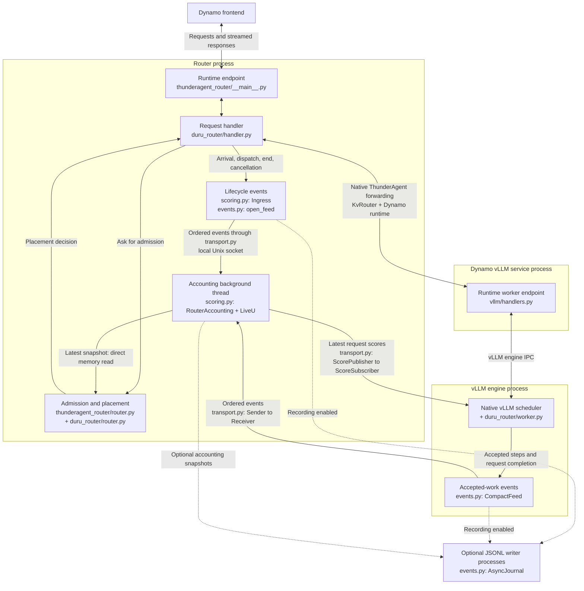

# Duru router

Duru provides fairness accounting, calibrated work prediction, and score-based
admission. This package integrates that policy with Dynamo and ThunderAgent.

## Reuse the policy

`admission.py` and the calibration predictor have no serving dependencies.
`scoring.py` combines in-memory U calculation, bounded event consumption, and
snapshot reading without importing ThunderAgent, vLLM, or the runtime.
`DuruPolicy` orders plain `Candidate` values, supplies admission ceilings, and
determines eligibility for the alpha exception. The host checks capacity and
selects replicas.

The ThunderAgent adapter subclasses the existing scheduler. It reuses admission
serialization, cancellation rollback, token accounting, background task lifecycle,
pressure pausing, program-state transactions, request streaming, and per-replica
capacity discovery. Pins contain both worker ID and DP rank. Adapter hooks retain
Duru's fresh-score waits and alpha-based admission. The default ThunderAgent policy
still uses its existing timeout and replica rules.

Another host supplies fresh scores, candidate demand/activity, and current capacity
and usage. It calls `order`, then checks capacity at the candidate's `ceiling`.
Only after a fit failure does it consult `may_force_admit` for the alpha exception.
Finish that candidate's admission or rejection before considering lower-ranked
backfill candidates. Update resource usage after each admission.
Clear `first_admission` after each attempted candidate, including a failed fit.
Compute `established_waiters` from the entire paused queue before filtering unknown
scores; this preserves headroom for existing waiters. Only eligible paused inference
requests set `pending_request=True`; idle agents cannot force admission.
The host owns cancellation, child dependencies, observation, and enforcement. Backend
calibration measurements and engine queue adapters remain backend-specific.

## The rule

1. Consider router admissions in decreasing U order. At the worker, order requests
   by decreasing U within each native waiting queue. vLLM retains precedence for
   requests already holding KV blocks and its pause handling.
2. The router may try another candidate when one cannot fit its admission budget.
   The worker uses native vLLM allocation behavior: if allocation fails, stop
   admission for that step. There is no worker backfill or vLLM source patch.
3. If normal router admission fails and the pending request has **U >= alpha**,
   admit it to the least-loaded eligible worker despite the router's budget.

A non-fitting high-U request can hold up smaller requests at the worker.

The worker still requires real KV space before executing a request. The exception
does not guarantee immediate GPU execution. Running requests keep the usual FCFS
behavior. There are no beta/gamma rules or fairness-based preemptions.

ThunderAgent still pauses agents in their tool phase when a worker is over its
memory budget, starting with smaller working sets. Its normal admission and resume
limits remain. Each session has its own reservation; U accounting is shared by the
root and its descendants when the ingress supplies their relationship. A parent
waiting for children retains its reservation until normal pressure pausing or session
termination releases it. Parent/child waits do not automatically release reservations or guarantee progress. These memory rules are not
additional U thresholds. Duru resumes by score and capacity; ThunderAgent's
30-minute forced-admission timer is off.

For a root with no accepted completed work, a pending request may use the predicted
cost of its next five engine steps for lookahead. Use only the submitted prompt,
observed cache state and matched calibration; unknown cache reuse is a miss.
After the first accepted root/descendant work, every child uses measured root U,
even if that child is new. First dispatch alone does not end lookahead.
Missing, invalid or stale accounting is not zero work and cannot trigger an exception.

Live accepted-work costs and next-five-step lookahead use the calibration grid's
edge-slope continuation outside its measured range: bilinear prefill and linear
decode. Accept only finite, positive predictions;
out-of-grid coordinates alone do not invalidate U. Snapshots count extrapolated predictor evaluations
(including lookahead and cache re-evaluations, not accepted steps or roots).
This does not certify calibration accuracy outside the measured grid.

## U accounting

U uses hierarchical processor sharing. At time t,
N is the number of roots with outstanding requests and k is the number of distinct
active agents of a root. Each agent's reference rate is `min(1, G/(N*k))`.
Equivalently, the root accrues entitlement at `min(k, G/N)`; divide its integral
by the root's summed calibrated accepted work. G counts matching TP replicas.

Requests waiting at the router or worker count as outstanding. Union overlapping
requests within one agent; do not count tool/child-join gaps with no request.
Divide the root share among active agents BEFORE applying the per-agent cap.
Unused shares are not redistributed, and total reference rate never exceeds G.

With G=2 and two roots, a two-child root gets total rate1 and a single-agent root
gets1. With G=4, they get2 and1 respectively. Fanout can use more of a root's
share but cannot raise its G/N ceiling.

U is normalized slowdown
relative to hierarchical processor sharing over outstanding requests. Tool time
and other gaps without outstanding requests do not accrue entitlement.

## Where to change the code

| File | Purpose |
| --- | --- |
| `admission.py` | Portable score ordering, admission ceilings, and alpha eligibility |
| `calibration/` | Graph-aware points, repeat measurements, shared cost predictor |
| `scoring.py` | Calculate U from events, publish scores, and read snapshots for the router/worker |
| `events.py` | Capture worker events in timestamp order; optional diagnostic recorder |
| `transport.py` | Ordered accounting events and latest request-score snapshots over Unix sockets |
| `router.py` | Supply the ordered queue and exception hooks to ThunderAgent; check score freshness |
| `worker.py` | Highest-U waiting order, fresh-score guard, and accepted-work observation |
| `handler.py` | Request identity, lifecycle events, and accounting supervision |
| `args.py` | Router CLI configuration |
| `__main__.py` | Shared ThunderAgent service startup and alpha checks |

## Processes and event flow

Dynamo runtime carries inference requests and streamed responses between services.
Duru's local Unix sockets carry accounting events and score snapshots. Accounting
runs on a background thread inside the router process; there is no separate live
scorer process. Runtime endpoints live inside their respective service processes.



The request and accounting paths meet through shared identities:

1. [handler.py](handler.py) assigns request, agent, and root IDs and reports arrival
   through `Ingress`. Parent and child agents share a root for U accounting.
2. [Duru's router.py](router.py) supplies queue order and admission exceptions.
   [ThunderAgent's router.py](../thunderagent_router/router.py) checks capacity,
   maintains reservations, and selects placement.
3. [ThunderAgent's handler](../thunderagent_router/__main__.py) forwards the request
   through `KvRouter` and Dynamo runtime. IDs travel in
   `extra_args.sampling_options.vllm_xargs`; [vllm/handlers.py](../vllm/handlers.py)
   puts them into `SamplingParams.extra_args` for the engine.
4. [worker.py](worker.py) observes accepted engine work and passes its IDs,
   prefill/decode coordinates, timestamps, and generated-token counts to
   `CompactFeed`. Worker completion acknowledgements let accounting safely release
   a finished root after any late accepted-work callbacks.
5. [scoring.py](scoring.py) joins lifecycle and work events by ID, updates
   entitlement and calibrated accepted work, and calculates U. Generated-token
   counts feed throughput diagnostics, not the U work-cost calculation.
6. Router admission reads the resulting snapshot directly from memory. Engine
   processes receive current request scores through [transport.py](transport.py)
   and use them to order their waiting queues.

[events.py](events.py) packages and optionally records events; it does not calculate
U or choose admissions. `CompactFeed` adds sequence numbers and timestamps and
emits periodic clock updates. Those updates let accounting find an observation
time covered by every producer. `open_feed()` connects each producer to the
bounded event transport. Every accounting event must arrive in order, while a
new score snapshot can replace an older one.

With `DURU_RECORD_EVENTS=1`, `AsyncJournal` also writes producer events and
accounting snapshots to JSONL through separate writer processes. With recording
off, those writer processes and files are absent; the live event and score paths
remain active.

## Use it

This adapter targets **vLLM 0.33.0** with its native asynchronous scheduler.
Current-runtime worker startup and GPU serving still need an integration check.
Calibration planning, measurement, and prediction are included in
[calibration/](calibration/README.md); the measurement CLI requires a serving
adapter supplied by the caller.

Select `dynamo.duru_router.worker.DuruScheduler` as the vLLM scheduler class.
Give each worker its own node-local `DURU_WORK_DIR`. `DURU_SCORES` names a logical
IPC channel, not a file. It is required; an unset or blank value fails startup.
Selecting the Duru scheduler enables the policy; this variable does not switch it
on or off. Use the same value in the router and every worker. Set
`DURU_IPC_DIR` to a fresh, private directory under `/dev/shm`, shared by all
participants on the same node, including containers. The default is
`/tmp/duru-<uid>`. Cross-node transport is not implemented. The launcher must
remove the directory after every participant exits. No measurement journal is
needed for live accounting.

The router entrypoint requires alpha explicitly:

```bash
export DURU_ACCOUNTING_CONFIG=/local/session/scoring.json
export DURU_SCORES=/local/session/scores
export DURU_IPC_DIR=$(mktemp -d /dev/shm/duru.XXXXXXXX)
python3 -m dynamo.duru_router --alpha 0.7 \
  --endpoint dynamo.vllm.generate --router-block-size 64
```

Supply the actual endpoint and block size for the deployment. The service uses
ThunderAgent's existing generate, status, and metrics endpoints. Worker metrics
use `"worker_id:dp_rank"` keys; `workers_total` counts replicas. Session lifecycle
is ACTIVE, PAUSED, or TERMINATED.

The public handler publishes request lifecycle and idle clock events automatically.
Use `agent_context.session_id` to retain accounting across turns and tool calls.
A child supplies `agent_context.parent_session_id` on its first request; the parent
must already be registered and open on the same router. Send
`agent_context.session_final=true` for every session once it is permanently done.
The handler cancels outstanding requests for that session and ends its reservation.
Root accounting is released only after every descendant has ended and workers have
acknowledged completion. Requests without a session ID receive a temporary root
that is closed after the request.

The handler generates fresh request IDs and stable root/agent IDs and forwards them
in `extra_args.sampling_options.vllm_xargs`. vLLM receives them as
`SamplingParams.extra_args` (`duru_request_id`, `duru_root_id`, `duru_agent_id`).
Client-provided values for those three fields are replaced. The configuration's
`duru-ingress.jsonl` and `compact-work.jsonl` paths name channels; these files are
created only when recording is enabled.

Embedders using `scoring.Ingress` directly must provide matching request, program,
root and agent identities, emit `dispatch` immediately before forwarding work,
and send request and session terminal events. A request ending is distinct from
a worker's `request_end` acknowledgement: late accepted work still counts until
that acknowledgement. Tool gaps retain accumulated E/W. Root cleanup frees
retained identities and E/W; global throughput counters remain.

The router owns `RouterAccounting`, which processes bounded event batches on a
background thread and publishes immutable Python snapshots. Router decisions read
these objects directly, with the same freshness checks. Engine processes receive
only request scores and their observation time through a Unix socket. Each engine
refreshes its latest snapshot on a background thread; scheduling reads memory
without waiting for socket I/O. There is no live `scores.json` file or file fallback.
There is no separate live scorer process. Set `DURU_ACCOUNTING_CONFIG` to the
following JSON configuration before starting the router. Embedded applications
start/close `RouterAccounting` alongside their scheduler and construct
`DuruScheduler(capacity, config, reader=accounting.reader)`. Each policy owns its
decision snapshot; independent routers do not share score state.

```json
{
  "ingress": "/local/session/ingress/duru-ingress.jsonl",
  "ledgers": ["/local/session/worker-0/compact-work.jsonl"],
  "scores": "/local/session/scores",
  "audit_dir": "/local/session/audit",
  "capacity": 1,
  "calibration": "/local/calibration/calibration.json",
  "runtime_contract": {"model": "your-model"}
}
```

Set `runtime_contract` to the actual serving contract recorded in the calibration
artifact. `capacity` counts TP replicas, not GPUs. `audit_dir` is optional and
defaults to the score directory. Run one accounting owner per score channel.
Live accounting runs inside the router and requires IPC; there is no standalone
scorer CLI or file-based score publication. Recorded-input replay exists only
in test helpers and offline benchmark analysis.

Memory is proportional to outstanding roots and their retained identities, with
hard safety caps: 16 MiB of queued messages per producer (plus bounded kernel socket buffers), 2 MiB per record, 262,144 staged
lifecycle/work events, 100,000 request identities, and a 32,768-entry cost cache. A producer
never overwrites unread work. Overflow or missing terminal notifications eventually
fails accounting closed; stale scores defer admission. These caps bound storage,
but do not make total accounting memory O(1) in workload concurrency.

The scorer waits for every source's timestamp before publishing. Memory transport
has one consumer and does not retain replay history: restart the whole accounting
session with fresh channels if the scorer crashes. `DURU_ACCOUNTING_TRANSPORT=journal`
is reserved for recording-only producers, such as the native baseline benchmark.
Starting live U accounting in that mode raises an error.

Closing `RouterAccounting` drains available records for up to five seconds and invalidates the
latest score snapshot. The service monitors accounting failures, rejects new work,
cancels queued/in-flight requests, and stops its endpoints if accounting fails.
Status reports starting until a fresh snapshot is available. Drain requests and close producers before stopping the
scorer. When recording is enabled, the audit footer states whether all inputs
closed and all pending work was consumed. A crash leaves scores to expire.

## Optional diagnostics

Set `DURU_DIAGNOSTICS=1` in the router environment and enable INFO
logging to record admission decisions and five-second performance summaries.
Unset it or set it to `0` to disable these additional logs (the default).
The router uses the application's logging configuration.

`duru.admission` records program/request/root IDs, measured U, effective score,
alpha, normal versus forced placement, worker, required tokens, remaining capacity,
ceiling, admission rank, and the score observation timestamp/run ID.
`duru.performance` records accepted output tokens/s and engine steps/s, active
requests/roots, active-root U min/mean/max, accounting lag, and pending event count.
Rates use counter deltas over wall-clock intervals; they reflect work consumed by
the scorer and can lag GPU execution. Use cutoff-exact journal analysis for paper
metrics. `DURU_RECORD_EVENTS=1` separately enables full producer recordings and
once-per-second per-root E/W/U audit snapshots for offline verification. It is off
by default; the live scorer continues consuming memory channels when it is on.
Detailed root snapshots are built only when diagnostics or recording is enabled.
Recorded source positions are event sequence numbers (`source_sequences`).

These logs do not drive scheduling. The performance logger keeps only the previous
counters, and emits no per-token messages. Admission logs grow with admissions;
retention/rotation is the responsibility of the application's log sink. This
option controls diagnostics independently of `DURU_RECORD_EVENTS`. Optional
recordings grow on disk and require retention limits; they are not the live
accounting state. Generated-token counts feed throughput counters, not U costs.

## Tests

Run the CPU tests in the Dynamo development environment:

```bash
PYTHONPATH=components/src python3 -m pytest components/src/dynamo/duru_router/tests -q
```

Tests cover U calculation, admission order, alpha boundaries, stale scores,
idle reservations, cancellation, worker callback accounting, and event transport.
`test_scoring.py` covers recorded-input replay, watermark ordering, identity
validation, and shutdown completeness. Router accounting and IPC tests cover live
publication, failure handling, and process separation. Native ThunderAgent tests exercise the shared machinery. Backend
stand-ins in CPU tests do not establish compatibility with a running vLLM worker.
