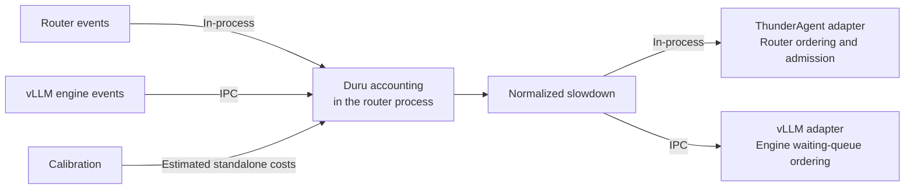

<!--
SPDX-FileCopyrightText: Copyright (c) 2026 Sehyeon Lee (sehyeon2@illinois.edu)
SPDX-License-Identifier: Apache-2.0
-->

# DEP: Pluggable Duru fairness policy with a ThunderAgent adapter

Area: router, with a separately reviewed vLLM adapter.

## Summary

Duru's philosophy is to measure how far each agent or multi-agent task has fallen
behind its fair share, then use that common signal to coordinate router admission
and runtime scheduling. This approach can be applied to different serving systems.

This DEP proposes an opt-in implementation on top of Dynamo's ThunderAgent router
and vLLM. ThunderAgent and vLLM adapters connect Duru’s fairness policy to the router
and engine schedulers.
ThunderAgent continues to own capacity checks, worker placement,
reservations, locking, pause/resume execution, and cancellation. Duru supplies
priority and admission-exception eligibility.

This proposal breaks it into small changes with independent tests and explicit
dependencies.

## Motivation

Agent requests alternate between generation and tool execution. Serving individual
requests in arrival order does not directly account for service received across
an agent's lifetime or across children of the same root. Duru uses accumulated
entitlement and accepted work to prioritize underserved roots.

ThunderAgent is the initial integration target because it already provides
program-level working-set accounting and admission control. Reusing those
mechanisms lets us add Duru's fairness decisions without maintaining a second
implementation of reservation and lifecycle management.

## Proposal

### General philosophy and this implementation

The accompanying paper, [*Towards Fair Resource Sharing in Agentic LLM Serving*](https://arxiv.org/abs/2611.23558v1),
defines normalized slowdown relative to ideal processor sharing (§3) and uses it
as a shared control signal across routing and runtime scheduling (§§5.1–5.5).
The goal is to reduce disproportionate agent-level delay while limiting throughput
loss.

**1. Slowdown: how much longer did the agent take under sharing?**

Compare the time an agent spends executing and waiting under sharing with the
inference time it would need alone:

$$
S = \frac{T_{\mathrm{shared}} + T_{\mathrm{queue}}}{T_{\mathrm{alone}}}.
$$

Here, $T_{\mathrm{shared}}$ is execution time under sharing and
$T_{\mathrm{queue}}$ is waiting time, following the paper's notation. Both
accumulate across the agent's LLM calls.

**2. Normalize for load: with a fixed number of agents, is that slowdown fair?**

Start with one worker and $N$ competing single-agent tasks, each with an
outstanding request. Under ideal equal sharing, each receives $1/N$ of the
worker, so its reference slowdown is $N$. Normalize by that reference:

$$
U = \frac{S}{N}.
$$

$U > 1$ identifies an agent that has fallen behind its fair share; $U < 1$ means it has received more.

**3. Let the number of competing agents change over time.**

Agents arrive, finish, and enter tool phases, so there is no single fixed $N$.
Instead, accumulate the agent's fair share at each instant when it has an
outstanding request:

$$
U = \frac{1}{T_{\mathrm{alone}}}
    \int_{\mathcal{I}} \frac{1}{N(t)}\,dt.
$$

Here, $\mathcal{I}$ contains the agent's waiting and execution intervals, and
$N(t)$ counts agents with outstanding requests at time $t$. When $N$ is
constant, $U$ reduces to $\frac{S}{N}$, recovering
the previous equation.

**4. Extend to multiple workers and multi-agent tasks.**

With $G(t)$ workers and $N(t)$ competing single-agent tasks, each agent's fair
share becomes $\min(1, G(t)/N(t))$, capped at one worker:

$$
U = \frac{1}{T_{\mathrm{alone}}}
    \int_{\mathcal{I}} \min\!\left(1, \frac{G(t)}{N(t)}\right)\,dt.
$$

To calculate this score while a task is running, use only the waiting and
execution intervals observed so far and the estimated standalone cost of
completed, accepted engine iterations. This requires no prediction of the task's
future requests or total work.

In the code, `E` accumulates $\int_{\mathcal{I}\cap[0,t]} \min(1, G(\tau)/N(\tau))\,d\tau$ and `W` estimates
$T_{\mathrm{alone,so\ far}}$, the standalone time for completed, accepted work,
giving `U = E / W` when `W > 0`.
We update both incrementally, estimating each completed iteration's standalone
time from offline points because it cannot be measured directly under sharing.

We call the root agent and its sub-agents working on the same multi-agent task
an **agent group**. The normalized slowdown for the group is the
$T_{\mathrm{alone,so\ far}}$-weighted average of its agents' normalized-slowdown
scores, using the per-agent share defined in step 4.

### Responsibilities

Components describe runtime responsibilities; PRs describe how we deliver them.
Some components span multiple PRs.

| Component | Responsibility | PR |
| --- | --- | --- |
| ThunderAgent adapter | We reuse ThunderAgent's capacity checks, placement, reservations and lifecycle management, and expose hooks for Duru decisions. | 1 |
| Event collection | Capture router lifecycle events and accepted vLLM work with request and root identities. | 2 |
| Event and score transport | Deliver ordered events to accounting and fresh score snapshots to engine processes. | 3 |
| Calibration | Measure and predict standalone execution costs for the deployment configuration. | 4 |
| U accounting and engine scheduling | Maintain E/W, clean up completed roots, publish scores and prioritize vLLM waiting requests. | 5 |
| Router ordering and serving integration | Prioritize waiting programs and connect Duru to the public serving path. | 6 |
| Admission exception | Authorize alpha-based exceptions after normal admission fails; ThunderAgent applies placement and reservation changes. | 7 |
| Documentation | Explain setup, configuration, architecture and evaluation in the READMEs and guides. | 8 |
| Diagnostics | Provide optional counters, logs and recordings alongside the components they describe. | 2–3, 5–7 |

The intended data flow is:

### How the score is calculated

Duru keeps two running totals for each agent group:

- `E` is the accumulated integral defined above: the worker time the group would
  have received under fair sharing while its requests were waiting or running.
  With `G` workers, `N` groups with outstanding requests, and `A` active agents in
  this group, each elapsed second adds `min(A, G/N)` to `E`. Multiple outstanding
  requests from the same agent count as one active agent.
- `W` is the estimated time the group's completed work would have taken alone.
  When vLLM finishes an engine step and keeps its result, Duru adds that step's
  estimated standalone cost, using measurements for the same model and serving
  configuration. Merely scheduling a step does not add to `W`, and discarded
  results do not count.

Once `W > 0`, the score is `U = E / W`. A higher score means the group has fallen
further behind its fair share, so Duru gives it higher priority.

### Lookahead: scoring a group before its first completed work

Initially `W = 0`, so `E / W` is undefined. For each waiting request, Duru estimates
how long its next five engine steps would take alone and temporarily uses:

$$
\mathrm{score} = \frac{E}{\text{estimated standalone time for the next five steps}}.
$$

As soon as the group has completed work with a valid cost, Duru switches to
`E / W` for every request in that group.

### Router order and the admission exception

The router tries waiting agents in decreasing score order. Equal scores use
earlier request arrival first. For each agent, it follows these steps:

1. Ask ThunderAgent whether the request fits within its normal capacity limit.
   If it fits, admit it.
2. If it does not fit, check the exception: a waiting request with a fresh, valid
   score **at least `alpha`** may be admitted beyond that normal limit.
   This uses the lookahead score before the group's first completed work and
   `E / W` afterward.
3. If neither check admits it, leave it waiting and try the next agent. A smaller,
   lower-scoring request may fit even when the higher-scoring one cannot.

### Queue order inside vLLM

After admission, a request may still wait inside vLLM. Duru uses the same scores
there: within each existing waiting queue, try the highest score first, with
earlier arrival breaking ties.

vLLM still checks actual memory availability and decides what can run. Duru does
not interrupt a running request just because another has a higher score.

### Keeping the scores current

The score calculation runs in the router process. The router reads its results
directly, and each engine receives updates in the background, so choosing the
next request does not wait for a message exchange.

Reports from the router and engines can arrive at different times.  Duru updates `E` and `W` only
through a time that both the router and engines have finished reporting.

Session IDs connect requests across turns, and child agents identify their parent.
Ending a session releases its router reservations. Duru keeps the group's totals
until the root agent and all its sub-agents have ended and workers have confirmed that
all dispatched requests are finished, so late work reports are counted before
cleanup. Pending events have a fixed memory limit; exceeding it stops accounting
instead of silently dropping work. If accounting fails, new requests and requests
still waiting at the router receive an explicit **503 (service unavailable)
error**. The router reports that Duru accounting is unavailable and new admissions
are stopped. It stays up to return errors and report its status. It does not
cancel requests already sent to an engine
because of this failure, and session cleanup remains available. It does not
switch to another scheduling policy. For now, admitting new requests again
requires resolving the failure and restarting the Duru router.

## Implementation plan: eight PRs

Organize the implementation around seven responsibilities, followed by one documentation PR. Each implementation PR includes its own tests, docstrings, and CLI help.
| PR | Responsibility | What it does | Depends on |
| --- | --- | --- | --- |
| 1 | ThunderAgent adapter | Define the boundary between Duru decisions and ThunderAgent mechanisms. Extract the minimum extension points for policy decisions and lifecycle observation, including reusable serving startup in `thunderagent_router/__main__.py` and CLI argument configuration in `thunderagent_router/args.py`. ThunderAgent retains capacity checks, worker placement, reservations, locking, pause/resume and cancellation. Preserve native defaults; introduce no Duru decisions. | None |
| 2 | Event collection | Define observations and capture request start/end, program/root identity, accepted engine work, and worker completion. Use an injected event sink so callback semantics can be tested without IPC. Observe native execution without changing queue order. | 1 |
| 3 | Transport | Connect producers and consumers across local processes. Deliver work events through bounded ordered channels, and deliver score snapshots through a separate latest-value channel. Include readers, freshness metadata, producer progress, shutdown and failure reporting. Test with synthetic events/scores; do not depend on the accounting implementation. | 2 |
| 4 | Calibration | Define the model/configuration-specific calibration artifact, measure solo work costs, and predict the cost of accepted work. Include planning and measurement tools, interpolation and contract validation. Keep measurement orchestration separate from the runtime predictor. | None |
| 5 | Duru runtime and engine scheduler | Consume observations, compute entitlement E and accepted work W, derive U, retain state through tool gaps, and release completed roots only after all work is accounted for. Publish fresh snapshots and use them to order waiting requests inside vLLM. Include background lifecycle, failure supervision and runtime diagnostics. | 2, 3, 4 |
| 6 | Router ordering and serving integration | Use the runtime's fresh scores to order programs waiting for ThunderAgent admission, including first admission and capacity backfill. Add the opt-in public entrypoint, configuration, identity/lifecycle wiring and CLI help. Keep the alpha exception disabled in this PR. | 1, 5 |
| 7 | Admission exception | After a candidate's normal router capacity check fails, permit the alpha-based exception when its fresh valid score qualifies. ThunderAgent still owns placement and reservation changes; the engine still requires real KV space. Complete alpha configuration and matched end-to-end evaluation. | 6 |
| 8 | Documentation | Add the Duru and calibration READMEs, architecture explanation, setup and configuration guide, supported-topology limitations, and evaluation instructions for the completed implementation. | 7 |

For example, a request completes a prefill step. Collection reports the accepted
work; transport delivers it; calibration estimates its cost; the runtime updates
that root's U. The router uses the resulting scores to order admissions. If a
candidate cannot fit normally, the exception rule may authorize admission. Once
requests are inside vLLM, Duru's normalized slowdown based ordering chooses which one to try
next, while native memory allocation remains authoritative.

## Requirements and validation

- Keep Duru's score calculation and scheduling rules separate from system-specific adapters.
- Preserve ThunderAgent's behavior when Duru is disabled, and reuse its capacity checks and state management.
- Report missing work events as errors, limit memory use, and release completed agent groups.
- Keep logging optional; scheduling must work without log or score files.

Test score calculation, event delivery, and scheduling; compare fairness, throughput,
and latency against unchanged baselines under the same workload and serving setup.

## Alternate Solutions

- Keep a separate Duru scheduler: avoids shared hooks but duplicates capacity and
  lifecycle logic, increasing the chance that fixes diverge.
- Change engine order only: smaller integration, but cannot prioritize programs
  waiting for admission at the router.

## Open review questions

1. Which policy/lifecycle hooks belong in ThunderAgent, and which should stay in
   the Duru adapter?
2. Is same-node IPC an acceptable initial scope, or is cross-node delivery a
   requirement before upstream integration?
3. What benchmark coverage and acceptable throughput tradeoff are required?

## References

- [*Towards Fair Resource Sharing in Agentic LLM Serving*](https://arxiv.org/abs/2611.23558v1), arXiv:2611.23558v1: §3 for normalized/live slowdown and calibration; §§5.1–5.5 for the control signal, coordinated ordering, and admission exceptions; §5.6 for autoscaling, which is outside this DEP.
- [Dynamo contribution guidance](https://github.com/ai-dynamo/dynamo/blob/main/CONTRIBUTING.md)
- [Dynamo DEP template](https://github.com/ai-dynamo/dynamo/blob/main/.github/ISSUE_TEMPLATE/dep.yml)
